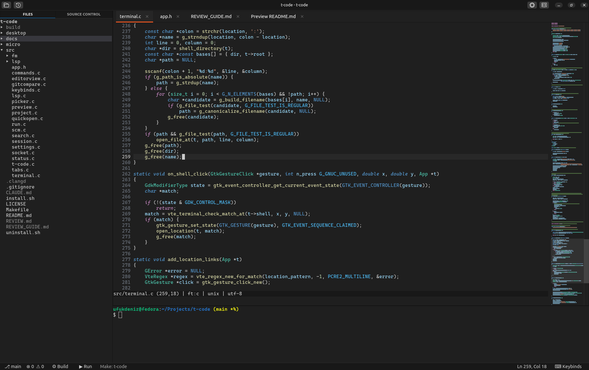

# t-code

One window, three kinds of terminals, nothing else.



<sub>A small Makefile project in git: the file manager marks the changed <code>main.c</code>, the editor marks the changed line in the gutter and clangd's unused-variable warning with <code>&gt;&gt;</code>, the header is open to the side, and the shell has built and run the program.</sub>

Two small C programs for Linux. Uses 100-150MB RAM (language server is not included). `t-code` (GTK4) is the window; every pane in it is a real terminal (VTE, the
same widget GNOME's terminals use):

- **left:** `t-code-fm`, a file manager written in plain C (no libraries)
- **right:** editor tabs, each one its own terminal running [micro](https://micro-editor.github.io)
  with clangd checking the code (micro is choosen because vim/neovim usage is hard for new users)
- **bottom:** your shell

All terminals use Cascadia Code and VS Code's Dark Modern colors, and C code is colored the way
VS Code colors it (`micro/colorschemes/dark-modern.micro`, `micro/syntax/c.yaml`).

micro runs with its own config in `micro/` (your `~/.config/micro` is untouched). Its only plugin,
the LSP client for clangd, is copied into `micro/plug/lsp` at a fixed version, so nothing downloads
or updates by itself.

## Requirements

`micro`, `clangd`, `git`, the Cascadia Code font, and to build: `gcc`, `make` and the GTK4, VTE,
WebKitGTK and md4c headers.

```sh
sudo dnf install gtk4-devel vte291-gtk4-devel webkitgtk6.0-devel md4c-devel
```

## Install

```sh
./install.sh
```

This builds t-code and installs it under `~/.local`: the `t-code` command, the file manager in
`libexec/t-code/`, the editor config in `share/t-code/micro/`, and a "t-code" entry in the app menu
(same icon as C IDE). Run it again after changing the code to update the installed copy.

To remove everything it installed:

```sh
./uninstall.sh
```

For development, `make` builds into `build/`, and `build/t-code` runs straight from the repo.

## Usage

```sh
t-code            # current directory
t-code path/dir
t-code a.c b.c    # open files as tabs
```

### Keys

The **⌨ Keybinds** button in the status bar shows all of them, and `Ctrl+Shift+P` (command
palette) finds any command by name.

| Where       | Key                                    | Action                                    |
|-------------|----------------------------------------|-------------------------------------------|
| anywhere    | `Ctrl+P`                               | open a file by typing part of its name    |
| anywhere    | `Ctrl+Shift+F`                         | search the text of all files              |
| anywhere    | `Ctrl+Shift+P`, `F1`                   | command palette                           |
| anywhere    | `Ctrl+G`                               | go to line                                |
| anywhere    | `F5` / `Ctrl+Shift+B`                  | build and run / build only (see below)    |
| anywhere    | `Ctrl+Alt+D` / `Ctrl+Alt+H`            | compare with the last commit / with a commit from the file's history |
| anywhere    | `Ctrl+Shift+V`                         | markdown preview of the current file      |
| anywhere    | `Ctrl+Shift+O`                         | open another project folder               |
| anywhere    | `Ctrl+\`                               | split the editor into two groups / join   |
| anywhere    | `Ctrl+1` / `Ctrl+2`                    | left / right editor group                 |
| anywhere    | `Ctrl+PageDown` / `Ctrl+PageUp`, `Alt+.` / `Alt+,` | next / previous tab           |
| anywhere    | `Alt+1` / `Alt+2` / `Alt+3`            | file manager / editor / shell             |
| anywhere    | `Ctrl+B` / `Ctrl+J`                    | hide / show the file manager / the shell  |
| anywhere    | `F7`                                   | code coloring on / off (all tabs)         |
| anywhere    | `Ctrl+=` / `Ctrl+-` / `Ctrl+0`         | bigger / smaller / normal text            |
| shell       | `Ctrl+Click` on `file.c:12:5`          | open the file at that line (compiler messages) |
| tab         | left click / middle click / `×`        | switch to / close / close                 |
| files       | click, `Enter`, `l`, `→`               | open folder, or open the file in a tab    |
| files       | `h`, `Backspace`, `←`                  | collapse folder / go to parent            |
| files       | `↑` `↓`, `j` `k`, wheel                 | move / scroll                             |
| files       | `a` / `r` / `d`, `Delete`              | new file (end with `/` for a folder) / rename / delete |
| files       | `Ctrl+X` / `Ctrl+C` / `Ctrl+V`         | cut / copy / paste files and folders      |
| files       | drag a row onto a folder               | move it there                             |
| files       | `.` / `R`                              | hide / show dotfiles (shown by default) / refresh |
| files       | right click                            | Open, Open to the Side, Open Preview, Compare with HEAD, File History, New File/Folder, Open in Terminal, Cut/Copy/Paste, Copy (Relative) Path, Rename, Delete, Open Folder as Project |
| editor      | `Ctrl+S` / `Ctrl+Q`                    | save / close this tab                     |
| editor      | `Ctrl+F`, `F3` / `Shift+F3`            | find, next / previous                     |
| editor      | `Tab`, `Ctrl+Space`                    | completion                                |
| editor      | `Alt+K`                                | signature of the symbol under the cursor  |
| editor      | `Alt+D` / `Alt+R`                      | go to definition / list references        |
| editor      | `Alt+F`                                | format the file with clangd               |

### What else is there

**Editing.** Files with changes are saved every second (micro's `autosave`), and closing a tab
saves too, so `Ctrl+S` is rarely needed; a tab shows `●` while its file has unsaved changes.
clangd marks problem lines with `>>` in the gutter; move the cursor onto the line to read the
message at the bottom. Everything else in the editor is plain micro (`Ctrl+C`/`Ctrl+V`, `Ctrl+Z`,
...; `Ctrl+E` opens its command bar, `help` there shows its help).

**Status bar**, like VS Code's: the git branch (`*` when there are changes), clangd's errors and
warnings in the open files, **⚙ Build** and **▶ Run** with what they would build, the cursor's
line and column, and **⌨ Keybinds**.

**Build and run.** F5 / Run saves, then builds and runs in the shell (Build stops after
building), looking upwards from the current file: a `CMakeLists.txt` is configured and built in
`build/` and the newest program there runs; a `Makefile` runs `make`, then `make run` if there is
a `run` target; otherwise the current C or C++ file is compiled on its own (with AddressSanitizer
and UBSan) into `build/` and run. Ctrl+click a `file.c:12:5` in the compiler's output to go there.

**Git.** The editor marks changed lines in the gutter like VS Code (blue changed, green added, red
where lines were deleted), following new commits by itself. **Compare with HEAD** (`Ctrl+Alt+D`)
and **File History** (`Ctrl+Alt+H`, pick a commit) open the old version read-only to the side:
both gutters then mark the differences between the two. Closing the old version goes back to
comparing with the last commit. The file manager colors files by their git state (modified,
added, untracked, conflicted, ignored) with the letter at the end of the row.

**File manager.** It refreshes by itself when files are added, removed or saved, and after a git
commit. Files and folders can be cut, copied and pasted (a name that is taken gets " copy"), or
dragged onto a folder.

**Split editor.** `Ctrl+\` (or the title bar button) puts a second group of tabs next to the
first. New files open in the group you are in; "Open to the Side" in the file manager opens a
file straight into the right group. Tabs can be dragged between the groups, and the right group
closes when its last tab does. A file is never open in both groups at once, since two editors
saving the same file would overwrite each other.

**Projects.** The title bar has buttons to open another folder and to pick a recent one.
Switching remembers and closes the current project's tabs, restarts the file manager and the
shell in the new folder, and brings back that folder's tabs from last time. t-code also remembers
the window size, pane sizes, hidden panes and text size (in `~/.config/t-code/session.ini`).

**Markdown preview** opens as a tab and follows the file as you type. Links to other markdown
files open their preview, other local files open in an editor, and web links open in the browser.

## Files

```
src/                 t-code, the window (see src/app.h for how the parts call each other)
  t-code.c           building the window, main()
  terminal.c         terminals; Ctrl+click on compiler messages in the shell
  tabs.c             editor tabs and the two groups
  commands.c         every command: shortcuts, command palette and the Keybinds list come from it
  picker.c           the popup list used by Ctrl+P, the palette, search and file history
  quickopen.c        Ctrl+P
  search.c           Ctrl+Shift+F (ripgrep)
  status.c           the status bar (and the thin title bar's style)
  keybinds.c         the Keybinds window
  project.c          switching folders, recent folders
  socket.c           requests from the file manager over $TCODE_SOCKET
  gitcompare.c       comparing with HEAD or a commit from the history
  run.c              build and run
  session.c          remembering the window and the tabs
  preview.c          markdown preview
  fm/                t-code-fm, the file manager (see src/fm/fm.h)
micro/               editor config: settings, colors, C syntax, the clangd plugin, and the tcode
                     plugin that reports the editor's state to t-code and sets the git comparison
desktop/             app menu entry template
install.sh, uninstall.sh
LICENSE
Makefile             also writes build/compile_commands.json, so clangd understands this code
```

## License

MIT, see [LICENSE](LICENSE). The clangd plugin in `micro/plug/lsp` is by Robert Kunze, also MIT
(its own LICENSE is next to it).
