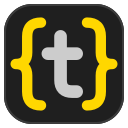

#  t-code

A light C/C++ IDE for Linux in one GTK4 window, with VS Code's Dark Modern look.

> **Since 0.2 the editor is GtkSourceView.** The editor tabs are no longer terminals running
> [micro](https://micro-editor.github.io): they are [GtkSourceView 5](https://gitlab.gnome.org/GNOME/gtksourceview)
> views inside the window, with clangd's errors underlined in red, completion and parameter hints
> while typing, and no process per tab. The micro-based t-code (0.1.1) lives on in the
> [`micro-main`](../../tree/micro-main) branch; [`docs/gtksourceview-plan.md`](docs/gtksourceview-plan.md)
> tells how the move went.

`t-code --version` prints the installed version.


<sub>t-code 0.2 open on its own repository.</sub>

Two small C programs:

- **left:** `t-code-fm`, a file manager written in plain C (no libraries), in a terminal (VTE)
- **right:** editor tabs (GtkSourceView), sharing one clangd
- **bottom:** your shell, in a terminal

### The editor

Like a plain text editor, without modes: `Ctrl+C` / `Ctrl+V`, `Ctrl+Z`, `Shift`+arrows to select,
the mouse. On top of that, like VS Code:

- **clangd's problems** are underlined with a wave (red errors, yellow warnings); resting the
  pointer on them shows the message, and on a symbol its type and signature. The status bar counts
  them, and a strip right of the minimap marks where they are in the whole file (click to go there).
- **Completion while typing** (and after `.`, `->`, `::`, or on `Ctrl+Space`): the list shows each
  symbol's kind, its parameters and type; a function goes in with its parameters as placeholders
  (`Tab` to the next one), and the `#include` it needs is added by itself.
- **Parameter hints**: in a call's arguments, the signature shows above the cursor with the
  argument being typed in bold.
- **Go to Definition** (`F12`, `Ctrl+Click`) and back (`Alt+←`), **Find All References**
  (`Shift+F12`), **Rename Symbol** (`F2`, in every file), **Format Document** (`Shift+Alt+F`, with
  the project's `.clang-format`).
- **Colors by meaning**: clangd tells functions (yellow), types (teal), macros (blue), constants and
  enum members (bright blue) and variables (light blue) apart; GtkSourceView colors keywords,
  strings, comments and the rest from VS Code's own theme (`styles/dark-modern.xml`). `.h` files
  open as C++ when they contain C++.
- Find and replace (`Ctrl+F`, `Ctrl+H`; case, whole word, regular expressions), go to line
  (`Ctrl+G`), comment lines (`Ctrl+/`), duplicate (`Ctrl+D`), move (`Alt+↑` / `Alt+↓`) and delete
  (`Ctrl+Shift+K`) lines, brackets and quotes that close by themselves, `Enter` between braces.
- A minimap, indent guides (the block around the cursor in its bracket color), the git diff gutter
  (green added, blue changed, red deleted), autosave a second after the last change.

clangd starts when the first C or C++ file is shown and stops a minute after the last one closes.
It gets a file only once its tab is shown, so a restored session with many tabs costs it little.
Other files (Markdown, Makefiles, scripts) get completion from the words in the file.

## Requirements

`clangd`, `git`, the Cascadia Code font (`ripgrep` is optional, for a faster Search panel), and to
build: `gcc` 14 (C23), `make` and the GTK4, GtkSourceView 5 (5.16 or newer), json-glib, VTE and
md4c headers. The packages below pull in all of these by themselves.

```sh
sudo dnf install gtk4-devel gtksourceview5-devel json-glib-devel vte291-gtk4-devel md4c-devel
```

## Install

### With a package (Fedora, Arch Linux, Debian, Void Linux)

t-code 0.2 has packages for Fedora 44, Arch Linux, Debian 13 (trixie) and Void Linux (glibc and
musl), x86_64. Install the one for your distribution; the package manager pulls in what it needs
(clangd, git and the Cascadia Code font among them):

```sh
sudo dnf install ./t-code-0.2-1.fc44.x86_64.rpm          # Fedora
sudo pacman -U t-code-0.2-1-x86_64.pkg.tar.zst           # Arch Linux
sudo apt install ./t-code_0.2-1_amd64.deb                # Debian
```

On Void Linux, xbps installs from a repository, so the downloaded package is indexed first (in
the folder it is in; use the `x86_64-musl` file on musl):

```sh
xbps-rindex -a t-code-0.2_1.x86_64.xbps
sudo xbps-install --repository="$PWD" t-code
```

Void has no package for Cascadia Code: t-code then uses the system's monospace font, and any
font can be picked in Settings. The Void packages were built and tested in Void containers.

Then start `t-code` from the app menu, or `t-code [folder]` in a terminal. To remove it, use
your package manager (`sudo dnf remove t-code`, `sudo pacman -R t-code`, `sudo apt remove t-code`,
`sudo xbps-remove t-code`).

A package puts `t-code` in `/usr/bin`, the file manager in `/usr/libexec/t-code/`
(`/usr/lib/t-code/` on Arch), the editor's colors in `/usr/share/t-code/styles/`, and the app menu
entry and icon.

### Building the packages yourself

All packages are built from this repository with one script. The Arch, Debian and Void packages
(and the Fedora one, when you are not on Fedora) are built in containers, so all you need is
`podman` or `docker`:

```sh
packaging/build.sh                # all, or pick: packaging/build.sh fedora arch debian void void-musl
packaging/test.sh                 # tries each package out in a fresh container
```

The packages land in `packaging/packages/<distribution>/` (with the debug and source packages);
`packaging/packages/release/` gets just the ones to publish and their `SHA256SUMS`. On Fedora, the RPM is
built directly with `rpmbuild`; install its build dependencies once with
`sudo dnf install rpm-build dnf-plugins-core && sudo dnf builddep packaging/fedora/t-code.spec`.

`packaging/test.sh` installs each package in a fresh container of its distribution (so the
package manager has to find every dependency), checks the installed files, and starts t-code on
a headless X server with five C files: the file manager and one clangd (with its malloc arena
limit) have to come up, a Markdown preview has to open, and t-code has to quit cleanly.
While they build, the packages also run the tests that need no display.

### From the source, into ~/.local

```sh
packaging/install.sh
```

This builds t-code and installs it under `~/.local`: the `t-code` command, the file manager in
`libexec/t-code/`, the editor's colors in `share/t-code/styles/`, and a "t-code" entry in the app menu
with its own icon (`desktop/io.github.tcode.svg`, installed to `~/.local/share/icons`). Run it again after changing the code to update the installed copy.

To remove everything it installed:

```sh
packaging/uninstall.sh
```

`make install` installs system-wide instead (`PREFIX=/usr/local` by default, `DESTDIR` for
staging; the packages use it). For development, `make` builds into `build/`, and `build/t-code`
runs straight from the repo.
`make test` runs the tests in `tests/` (the editor, language server, Search panel and Source Control
ones need a display; they open no window). `make test-asan` runs the ones without GTK again under
AddressSanitizer, which also fails on memory leaks. `.clang-format` is the code's style
(2 spaces); clangd and Format Document use it. `tools/` has scripts that measure what a
running t-code costs in memory and CPU (`tools/proc-report.sh`), or run it invisibly to measure a
change (`tools/headless.sh`).

## Contributing

If you want to contribute, all contributions will be gladly accepted. Please open a pull request.

## AI Usage in Project  

Most of the structure and code written with using AI coding agent. Every single line of code is reviewed or currently under review. I did not spend enough time to write just myself because I just want an ide that uses not much ram as immediately as possible, vscode was using too much then I got angry and tada... BUT I will review every detail of this project and after than I will continue to add new features as I wish.

## Usage

```sh
t-code            # current directory
t-code path/dir
t-code a.c b.c    # open files as tabs
```

### Keys

The **⌨ Keybinds** button in the status bar shows all of them, and `Ctrl+Shift+P` (command
palette) finds any command by name.

| Where       | Key                                    | Action                                    |
|-------------|----------------------------------------|-------------------------------------------|
| anywhere    | `Ctrl+P`                               | open a file by typing part of its name    |
| anywhere    | `Ctrl+Shift+F`                         | search the text of all files (the Search tab) |
| anywhere    | `Ctrl+Shift+P`, `F1`                   | command palette                           |
| anywhere    | `Ctrl+G`                               | go to line                                |
| anywhere    | `F5` / `Ctrl+Shift+B`                  | build and run / build only (see below)    |
| anywhere    | `Ctrl+Alt+D` / `Ctrl+Alt+H`            | compare with the last commit / with a commit from the file's history |
| anywhere    | `Ctrl+Shift+V`                         | markdown preview of the current file      |
| anywhere    | `Ctrl+Shift+O`                         | open another project folder               |
| anywhere    | `Ctrl+\`                               | split the editor into two groups / join   |
| anywhere    | `Ctrl+1` / `Ctrl+2`                    | left / right editor group                 |
| anywhere    | `Ctrl+PageDown` / `Ctrl+PageUp`, `Alt+.` / `Alt+,` | next / previous tab           |
| anywhere    | `Alt+1` / `Alt+2` / `Alt+3`            | file manager / editor / shell             |
| anywhere    | `Ctrl+B` / `Ctrl+J`                    | hide / show the file manager / the shell  |
| anywhere    | `F7`                                   | code coloring on / off (all tabs)         |
| anywhere    | `Ctrl+=` / `Ctrl+-` / `Ctrl+0`         | bigger / smaller / normal text            |
| shell       | `Ctrl+Click` on `file.c:12:5`          | open the file at that line (compiler messages) |
| tab         | left click / middle click / `×`        | switch to / close / close                 |
| files       | click, `Enter`, `l`, `→`               | open folder, or open the file in a tab    |
| files       | `h`, `Backspace`, `←`                  | collapse folder / go to parent            |
| files       | `↑` `↓`, `j` `k`, wheel                 | move / scroll                             |
| files       | `a` / `r` / `d`, `Delete`              | new file (end with `/` for a folder) / rename / delete |
| files       | `Ctrl+X` / `Ctrl+C` / `Ctrl+V`         | cut / copy / paste files and folders      |
| files       | drag a row onto a folder               | move it there                             |
| files       | `.` / `R`                              | hide / show dotfiles (shown by default) / refresh |
| files       | right click                            | Open, Open to the Side, Open Preview, Compare with HEAD, File History, New File/Folder, Open in Terminal, Cut/Copy/Paste, Copy (Relative) Path, Rename, Delete, Open Folder as Project |
| editor      | `Ctrl+S` / `Ctrl+W`                    | save / close this tab                     |
| editor      | `Ctrl+F` / `Ctrl+H`, `F3` / `Shift+F3` | find / replace, next / previous           |
| editor      | `Ctrl+/`, `Ctrl+D`, `Ctrl+Shift+K`     | comment lines, duplicate, delete them     |
| editor      | `Alt+↑` / `Alt+↓`                      | move lines up / down                      |
| editor      | `Ctrl+Z` / `Ctrl+Y`, `Ctrl+Shift+Z`    | undo / redo                               |
| editor      | `Ctrl+Space` / `Ctrl+Shift+Space`      | completion / parameter hints              |
| editor      | `F12`, `Ctrl+Click` / `Alt+←`          | go to definition / back                   |
| editor      | `Shift+F12` / `F2`                     | find all references / rename symbol       |
| editor      | `Shift+Alt+F`                          | format the file with clangd               |

### What else is there

**Editing.** A file with changes is saved a second after the last one (the autosave setting), so
`Ctrl+S` is rarely needed; a tab shows `●` while its file has unsaved changes, and closing it then
asks whether to save. A file changed on disk (a `git checkout`, another program) is loaded again
when the editor has nothing unsaved.

**Status bar**, like VS Code's: the git branch (`*` when there are changes), clangd's errors and
warnings in the open files, **⚙ Build** and **▶ Run** with what they would build, the cursor's
line and column, and **⌨ Keybinds**.

**Build and run.** F5 / Run saves, then builds and runs in the shell (Build stops after
building), looking upwards from the current file: a `CMakeLists.txt` is configured and built in
`build/` and the newest program there runs; a `Makefile` runs `make`, then `make run` if there is
a `run` target; otherwise the current C or C++ file is compiled on its own (with AddressSanitizer
and UBSan) into `build/` and run. Ctrl+click a `file.c:12:5` in the compiler's output to go there.

**Git.** The editor marks changed lines in the gutter like VS Code (blue changed, green added, red
where lines were deleted), following new commits by itself. **Compare with HEAD** (`Ctrl+Alt+D`)
and **File History** (`Ctrl+Alt+H`, pick a commit) open the old version read-only to the side:
both gutters then mark the differences between the two. Closing the old version goes back to
comparing with the last commit. The file manager colors files by their git state (modified,
added, untracked, conflicted, ignored) with the letter at the end of the row.

**File manager.** It refreshes by itself when files are added, removed or saved, and after a git
commit. Files and folders can be cut, copied and pasted (a name that is taken gets " copy"), or
dragged onto a folder.

**Split editor.** `Ctrl+\` (or the title bar button) puts a second group of tabs next to the
first. New files open in the group you are in; "Open to the Side" in the file manager opens a
file straight into the right group. Tabs can be dragged between the groups, and the right group
closes when its last tab does. A file is never open in both groups at once, since two editors
saving the same file would overwrite each other.

**Projects.** The title bar has buttons to open another folder and to pick a recent one.
For a second project next to the first, middle-click the dock icon (or pick "New Window" from
its menu, or run `t-code --new-window`): a new window opens and asks for a folder.
Switching remembers and closes the current project's tabs, restarts the file manager and the
shell in the new folder, and brings back that folder's tabs from last time. t-code also remembers
the window size, pane sizes, hidden panes and text size (in `~/.config/t-code/session.ini`).

**Search** (`Ctrl+Shift+F`), a tab next to Files and Source Control, like VS Code's: results
come as you type, grouped by file with the matches marked. **Aa**, **ab** and **.\*** next to the
text turn on Match Case, Match Whole Word and regular expressions; **⋯** shows "files to include"
and "files to exclude" (comma separated globs such as `*.c, src`). Click a file to fold its
results, a result to open the file there. ripgrep skips what `.gitignore` ignores; without it,
grep searches everything but `.git` and `build`.

**Settings** (`Ctrl+,` or the gear in the title bar): minimap, code coloring, indent guides,
word wrap (off by default; with it off, long lines run off the screen and scroll sideways with
the horizontal scrollbar or Shift + wheel), tab size (2 by default), spaces for Tab, detecting a file's own indentation, autosave,
format on save (`Ctrl+S` formats C and C++ first; off by default), clang-tidy checks (the project's
`.clang-tidy`; off by default), fonts, text size and reopening the last project. Changes apply at
once, to the open editors too, and are kept in `session.ini`.

**Markdown preview** opens as a tab and follows the file as you type. It is drawn natively
(md4c into a GTK text view, no browser engine): headings, lists, quotes, code blocks colored like
the editor, tables whose cells wrap, local images. Links to other markdown files open their
preview, other local files open in an editor, and web links open in the browser.

## Performance

t-code is meant to be light: GtkSourceView editors in one process, a small terminal file manager,
and one clangd that only knows the files you have looked at.

Measured on Fedora 44 (x86_64) with `tools/headless.sh` (t-code run invisibly, then
`tools/proc-report.sh`), the same 25 C files of this repository opened, each tab then shown in
turn, against the micro-based 0.1.1 run the same way. Memory is PSS: pages shared between processes
are split between them, so the rows add up.

| all 25 tabs shown | 0.1.1 (micro) | 0.2 (GtkSourceView) |
|---|---:|---:|
| editors | 25 micro processes, 412 MB | in the window |
| t-code window | 57 MB | 83 MB |
| helper processes per editor | 50, 6 MB | none |
| clangd | 361 MB | 470 MB |
| **memory in all** | **839 MB** | **557 MB** |

clangd's share moves a lot between runs (its background index, what it has freed back); the rest
is steady. With 25 tabs open and only one shown, both come to about 60 MB besides clangd: 0.1.1
started micro (about 20 MB) for each tab shown, an editor now costs its file and a few MB in the
window. While idle, t-code uses no CPU: nothing polls, editors redraw only when something changes.

What keeps it small:

- **clangd gets a file once its tab is shown**, and stops a minute after the last C or C++ file
  closes. It keeps at most five files open: the least recently used hidden tab is closed on the
  server (its AST freed) and opened again when you go back to it.
- **clangd's own flags**: precompiled headers on disk (`--pch-storage=disk`), two indexing
  threads, at most 50 results, and `--malloc-trim` on glibc.
- **clangd runs with two malloc arenas** (`GLIBC_TUNABLES=glibc.malloc.arena_max=2`). With 25
  files clangd itself accounted for 130 MB, yet held 1.5 GB: glibc's per-thread arenas kept
  memory it had freed. With two arenas it stays at a third of that, at the same speed.
- **Only what changed goes to clangd** (incremental sync), batched while typing.
- **No browser engine**: the Markdown preview is a text view, not WebKit (which started a web and
  a network process, 150-200 MB, per preview).
- **Freed memory goes back**: t-code calls glibc's `malloc_trim(0)` when a tab closes, a search
  ends and the project changes.
- **The file manager does not watch build output**: `build/`, `target/`, `node_modules/`, `.git/`
  and `.cache/` are never watched, and a burst of changes refreshes the tree once (250 ms).

How to measure it yourself (see `tools/`):

```sh
tools/proc-report.sh 10              # the running t-code: processes, memory and CPU by program
tools/headless.sh src/*/*.c          # build/t-code run invisibly with these files, then the same report
tools/clangd-mem.py --churn 3        # clangd alone: resident memory vs what it says it uses
make test-asan                       # the tests without GTK under AddressSanitizer, failing on any leak
```

The tests also check memory: `tests/test_lsp.c` opens and closes a file 200 times against a fake
language server and fails if the heap grows by 8 KB (it grows by a few hundred bytes; a leak of 130
bytes a round fails it), and the package tests check that one clangd serves all editors with the
arena limit.

## Files

```
src/                 t-code, the window (src/app.h: the shared types and a map of the folders;
                     every .c file has a .h next to it with what it offers the others)
  main.c             start and quit: the command line, the application, signals
  window/            the window: layout and panes (window.c), where the helpers are (paths.c),
                     theme, terminals and Ctrl+click on compiler messages (terminal.c), the status
                     bar, every command: shortcuts, palette and Keybinds list (commands.c)
  editor/            editor tabs and the two groups (tabs.c), opening, saving, autosave and closing
                     (editor.c), the page with the minimap and its look (editorview.c), editing
                     commands and typing help (editing.c), the find bar (findbar.c), indent guides
                     (guides.c), the git diff gutter (diffgutter.c), a file's indentation and
                     language (detect.c); markdown preview (preview.c)
  lsp/               the language server: the client and clangd's lifetime (client.c, over
                     channel.c), problems (diagnostics.c), hover, completion, parameter hints
                     (signature.c), definition / references / rename / format (navigate.c, edits.c),
                     colors by meaning (semantic.c)
  search/            the Search tab, Ctrl+Shift+F (ripgrep); searchmatch.c is its GLib-only part
  git/               the Source Control tab (scm.c), git status in the background (gitstatus.c),
                     comparing with HEAD or a commit from the history (compare.c), line differences
                     for the gutter (linediff.c)
  popups/            the popup list (picker.c) used by Ctrl+P (quickopen.c), the palette, history,
                     references and rename
  dialogs/           the Settings, Keyboard Shortcuts and About windows
  project/           switching folders (project.c), remembering the window and tabs (session.c),
                     build and run (run.c)
  ipc/               requests from the file manager over $TCODE_SOCKET (socket.c)
  fm/                t-code-fm, the file manager (see src/fm/fm.h)
styles/              the editor's colors: VS Code Dark Modern as a GtkSourceView style scheme
tests/               make test: editing and the find bar, the language server client (with a fake
                     server), detect.c, linediff.c, searchmatch.c, the Search panel, Source Control
                     and About; make test-asan: the ones without GTK under ASan
tools/               measuring memory and CPU: the running process tree, a headless t-code, clangd
desktop/             app menu entry template and the app icon
packaging/           install.sh, uninstall.sh, build.sh, test.sh: Fedora (fedora/t-code.spec), Arch
                     (arch/PKGBUILD), Debian (debian/debian/) and Void Linux (void/) packages, built
                     into packaging/packages/ (not in git)
.clang-format        the code's style (2 spaces); clangd formats with it
LICENSE
Makefile             VERSION, make install; also writes build/compile_commands.json, so clangd
                     understands this code
```

## License

MIT, see [LICENSE](LICENSE).
